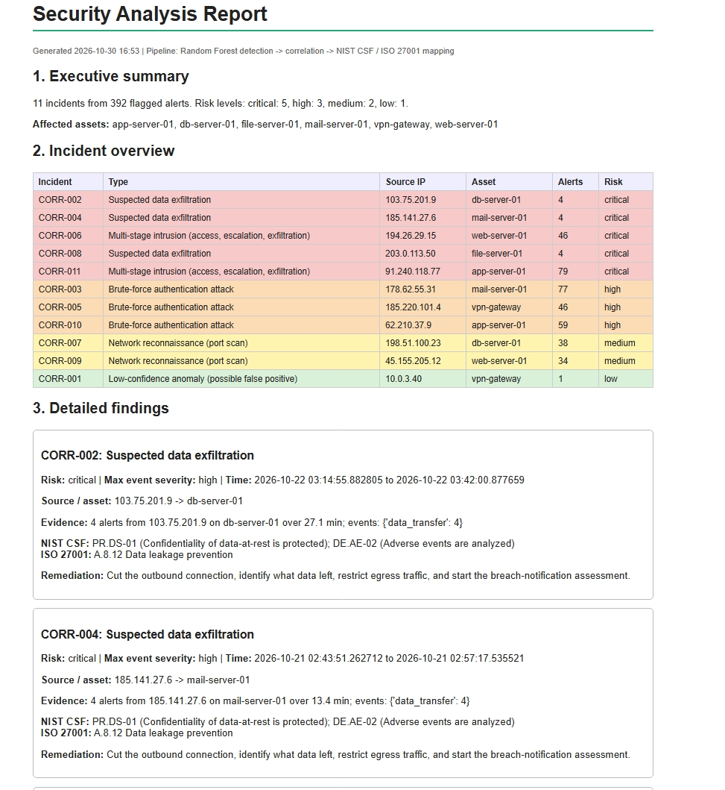

# Mini SOC: ML-Based Security Log Analysis Prototype

Prototype of SOC. It detects
suspicious events with ML, correlates alerts into incidents, maps findings
to NIST CSF / ISO 27001, and generates a report through a FastAPI backend.

## Pipeline
generate logs -> preprocess + features -> Random Forest detection ->
correlate by IP + asset + time gap -> compliance mapping -> API + report

## Project structure
| Path | Purpose |
|---|---|
| `src/data_generator.py` | Synthetic logs with injected attacks and ground truth |
| `src/preprocess.py` | Cleaning, basic and backward-looking window features |
| `src/train.py` | Trains and evaluates Random Forest and Isolation Forest |
| `src/correlate.py` | Groups alerts into incidents, graded against scenario_id |
| `src/compliance.py` + `config/compliance_map.json` | Maps incidents to controls |
| `src/connectors.py` | CSV log connector and AbuseIPDB threat intel (optional key) |
| `app/main.py` | FastAPI app with Pydantic validation |
| `src/report.py` | HTML security report |

## Setup
```bash
python -m venv .venv
.venv\Scripts\activate        # Mac/Linux: source .venv/bin/activate
pip install -r requirements.txt
```
Optional: copy `.env.example` to `.env` and add an AbuseIPDB key. Without a
key the threat-intel lookup returns "unavailable" and nothing breaks.

## Run (from the project root, in order)
```bash
python src/data_generator.py   # data/raw/security_logs.csv
python src/train.py            # models/rf_model.joblib + metrics
python src/correlate.py        # incidents + grading vs ground truth
python src/compliance.py       # data/processed/findings.json
python src/report.py           # reports/security_report.html
uvicorn app.main:app --reload  # API docs at http://127.0.0.1:8000/docs
```
Endpoints: `GET /health`, `GET /analyze/sample`, `POST /analyze`, `GET /report`.

## Data source
Synthetic, seed 42: 10,112 events over 7 days, 393 suspicious (3.89%), 10
injected incidents (brute force, port scan, exfiltration, multi-stage).
`scenario_id` and `attack_type` are ground truth only, never model inputs.

## Results (test period Oct 24-25, time-based split)
| Model | Precision | Recall | F1 | FP | FN |
|---|---|---|---|---|---|
| RF, all features | 1.000 | 1.000 | 1.000 | 0 | 0 |
| RF, behaviour only (saved) | 0.992 | 0.984 | 0.988 | 1 | 2 |
| Isolation Forest | 0.785 | 0.907 | 0.842 | 32 | 12 |

The all-features model scored 100% because `is_external_ip` and
`severity_num` leak the label in synthetic data. I removed them and use the
behaviour-only model. Correlation: 11 incidents (10 real + 1 false
positive), no over-merging or under-merging against ground truth.

## Screenshots



## Known limitations
- Synthetic data is cleaner than real logs; metrics are optimistic.
- Test period has only 3 incidents and no port scans; exfiltration has very few rows.
- `port_probe` and `privilege_escalation` never occur in normal traffic.
- Early rows of a brute force look like typos and can be missed.
- Window features only see the submitted batch.
- Correlation was demonstrated on the full dataset, including training rows.
- Isolation Forest `contamination=0.04` is assumed, which needs known data.
- Compliance mapping is illustrative and needs specialist validation.
- Window feature code loops per IP, so it is slow for millions of rows.